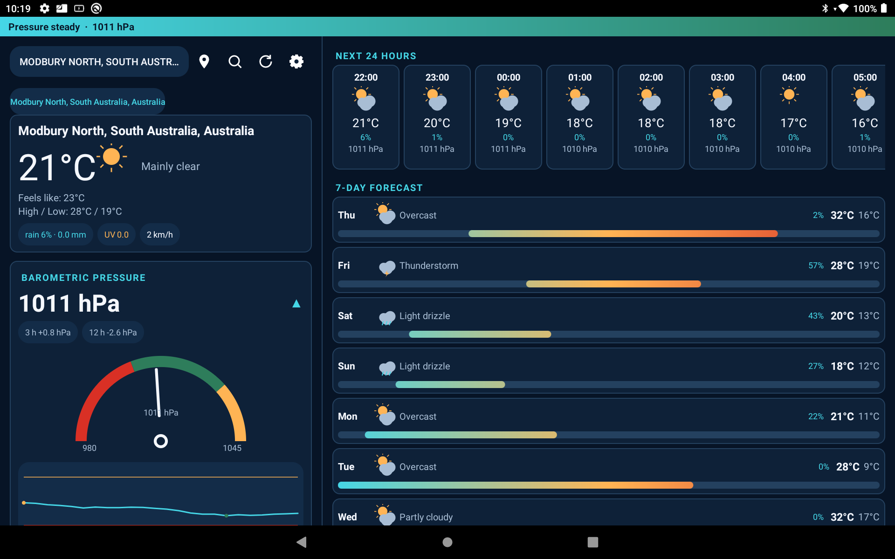

# BaroWeather

A detailed, pressure-first weather app for Android, designed for small phones and
tablets. Its distinguishing feature is an expanded barometric-pressure warning
system: low, falling, and very high pressure are called out in a red banner at
the top of the screen so pressure-sensitive users can take precautions.



*Dashboard screenshot from the test tablet (Lenovo TB-X606F, Android 10).*

Project folder: `D:\opencode_home_win\038_2026_11_27_BaroWeather`

## Status

Design pass: **complete**. v0.1–v0.3 code and APKs: **complete and device-smoke-tested**.
v0.4.0 bonus set and v0.4.1 reading/rain refinements: **complete and device-smoke-tested**.

- v0.2 added the long-range pressure histogram and reading/visibility settings.
- v0.3 added full landscape layouts and an explicit orientation setting.
- v0.4 adds the pressure story, symptom log, quiet incoming-pressure alerts,
  home-screen widget, saved places, colour-blind-safe chart patterns, reduce-motion
  control, and PNG/CSV history export.
- v0.4.1 adds rain chance and millimetres in expanded forecast rows, a 110% text
  scale, three new high-contrast themes, and single-line large temperature text.

See `VERIFICATION.md` for the build and device results.

## Highlights

- **Pressure first.** Sea-level pressure, trend, gauge, sparkline and warning
  banner lead the dashboard; surface pressure is secondary.
- **Plain-language pressure story.** A short card explains the last 24 h, the
  next 12 h and what the current alert means.
- **Private symptom log.** Add optional notes tied to the current pressure
  reading; entries appear as warm dots on the history chart and in CSV exports.
- **Quiet alerts.** An optional platform notification checks forecast pressure
  every six hours, deduplicates by alert level and respects the 1-hour banner Ack.
- **Home-screen widget.** Shows the cached sea-level pressure, place and warning
  colour strip; tapping it opens the app.
- **Multiple saved places.** Search or device locations can be saved and switched
  from a horizontal chip strip, including the tablet left rail.
- **Rain detail.** Chance of rain (%) and expected amount (mm) in the hero chip,
  hourly/daily rows and expanded details, plus a `Rain today` details entry.
- **Accessible history.** Optional diagonal/horizontal/vertical hatch patterns,
  a reduce-motion switch, 100–200% text scale, seven themes and TalkBack labels.
- **Shareable history.** Export the visible chart as PNG or the full pressure
  series and symptom annotations as CSV using platform sharing only.
- **Offline-friendly.** The last forecast and long-range series are cached; the
  app shows an `OFFLINE DATA` chip when it cannot refresh.

## Design decisions

- **Cross-platform logic in Rust.** The pressure assessment, trend detection,
  unit conversion and WMO weather-code mapping live in `core/`. They are tested
  on Windows and exposed to Android through a small JNI bridge.
- **Android UI in Java with platform APIs only.** No Gradle, no Play Services,
  no ad/analytics SDKs, no third-party jars. Notifications, widgets, export URI
  sharing and background jobs all use Android platform APIs.
- **Java fallback.** A Java implementation of the same pressure rules runs when
  the native `.so` is unavailable, so the APK still works on unsupported ABIs.
- **Data source: Open-Meteo Forecast API.** No API key is required for
  non-commercial use. The app requests current conditions, hourly pressure,
  hourly/daily forecast and geocoding over HTTPS. The long-range chart asks for
  up to 92 past days and 16 forecast days, then caches the response.
- **Minimum Android:** API 21 (Android 5.0). Target/build: API 35. The native
  library is built for arm64, armv7 and x86_64; the Java fallback covers any
  missing ABI.

## Pressure warnings

See `PRESSURE_ALERTS.md`. Defaults:

- Low current pressure: `< 1005 hPa` sea-level pressure.
- Very high current pressure: `> 1030 hPa`.
- Incoming low: forecast low in the next 12 h below the low threshold, or a
  fall of `>= 4 hPa` in 12 h / `>= 2 hPa` in 3 h.
- Incoming high: forecast high above the high threshold, or a rise of the same
  magnitude.
- Thresholds and trend sensitivity are user-configurable.
- The banner is **red** for both incoming and present low/high pressure.

This is informational, not medical advice.

## GUI design

See `DESIGN_GUI.md` for the full layout, palette, widget inventory and
phone/tablet variants.

Tap the pressure gauge or the large pressure value to open the long-range
histogram. It shows hourly or daily bars, 7/30/all-day windows, threshold guides,
a tap tooltip, and min/max/average/change/forecast statistics. Optional hatch
patterns make the three pressure bands distinguishable without relying on colour.
It has a wide, labelled landscape layout with extra top clearance. The dashboard
also has dedicated phone-landscape and tablet-landscape two-pane layouts.
Settings include `Follow device`, `Portrait only` or `Landscape only`, 100/110/
125/150/175/200% text scaling, seven themes (Dark, Light, two high-contrast
themes, plus Blue, Navy and Matrix green high contrast), chart patterns and a
reduce-motion switch. The large temperature auto-fits on one line even at high
text scales.

## Project folders

| Path | Purpose |
| --- | --- |
| `core/` | Rust cross-platform pressure/weather logic and tests |
| `android/` | AndroidManifest, Java UI, resources, JNI bridge, build scripts |
| `dist/android/` | Built APK |
| `reports/` | Data-source notes |
| Root docs | `DESIGN_GUI.md`, `PRESSURE_ALERTS.md`, `FEATURE_BACKLOG.md`, `VERIFICATION.md`, `goals.txt` |

## Build and install

Build everything from the local toolchain (no Gradle and no network fetch of
dependencies):

```powershell
& 'D:\opencode_home_win\038_2026_11_27_BaroWeather\android\build-native.ps1'
& 'D:\opencode_home_win\038_2026_11_27_BaroWeather\android\build-apk.ps1'
```

Output: `dist\android\baroweather-0.4.1.apk` (versionCode 4). Earlier signed
APKs are retained locally for the backup record. The local signing keystore
`android\debug.jks` is deliberately excluded from the public repository.

The connected test device is `HPV2VPC2` (Lenovo TB-X606F, Android 10).

## Publishing

Public repository: `https://github.com/criterball/BaroWeather`.

Deferred to a later release: the alternative weather provider (feature 9) and
localisation into Spanish, French, German and Polish. Those are listed at the end
of `FEATURE_BACKLOG.md`.
